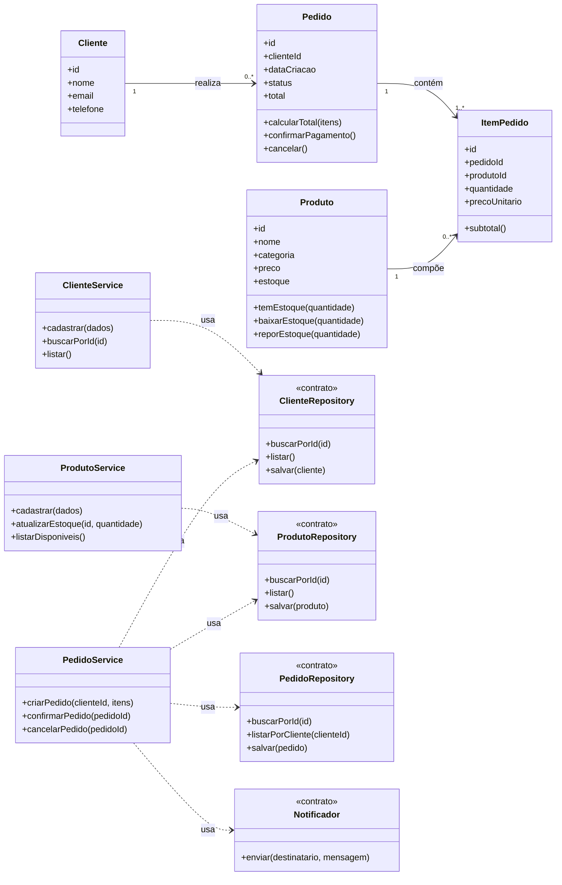

# Modelagem — Projeto 1

**Aluno(a):** Sávio da Costa Silva
**Domínio:** Gestão de pedidos de uma loja de artigos esportivos

## 1. O domínio

A loja vende camisas de times, chuteiras e acessórios esportivos para clientes cadastrados. Cada pedido agrupa um ou mais itens de produtos disponíveis em estoque, calcula o valor total da compra e controla o status do pedido (aberto, pago ou cancelado).

## 2. Entidades

| Entidade | Atributos | Relacionamentos |
|---|---|---|
| Cliente | id, nome, email, telefone | realiza vários pedidos |
| Produto | id, nome, categoria, preco, estoque | aparece em vários itens de pedido |
| Pedido | id, clienteId, dataCriacao, status, total | pertence a um cliente e possui vários itens |
| ItemPedido | id, pedidoId, produtoId, quantidade, precoUnitario | pertence a um pedido e referencia um produto |

## 3. Diagrama de classes

## 4. Responsabilidades

| Classe | Papel | Único motivo para mudar |
|---|---|---|
| Cliente, Produto, Pedido, ItemPedido | entidades | as regras intrínsecas do próprio objeto (ex.: baixa de estoque, cálculo de subtotal e transição de status) |
| ClienteService, ProdutoService, PedidoService | regra de negócio | os fluxos de cadastro, fechamento e cancelamento de pedidos |
| ClienteRepository, ProdutoRepository, PedidoRepository | acesso aos dados | a tecnologia de persistência (memória na S3, SQLite na S5) |
| Notificador | comunicação | o meio de envio de confirmação de pedido ao cliente (e-mail ou mensagem) |

## 5. Onde apliquei SRP e DIP

- **SRP:** nenhuma entidade salva a si mesma no banco nem dispara notificações. Cada classe possui um único motivo para mudar: entidades cuidam do seu estado e regras locais, repositories isolam a persistência, o Notificador cuida da comunicação e os services coordenam os casos de uso.
- **DIP:** os services dependem exclusivamente das abstrações (`<<contrato>>`) dos repositories e do Notificador, injetadas via construtor, sem conhecer detalhes concretos de arrays em memória ou banco SQLite.

## 6. Fora do escopo (YAGNI)

Autenticação de usuários, gateway de pagamento online, cálculo de frete e relatórios gerenciais ficam fora do Projeto 1.
